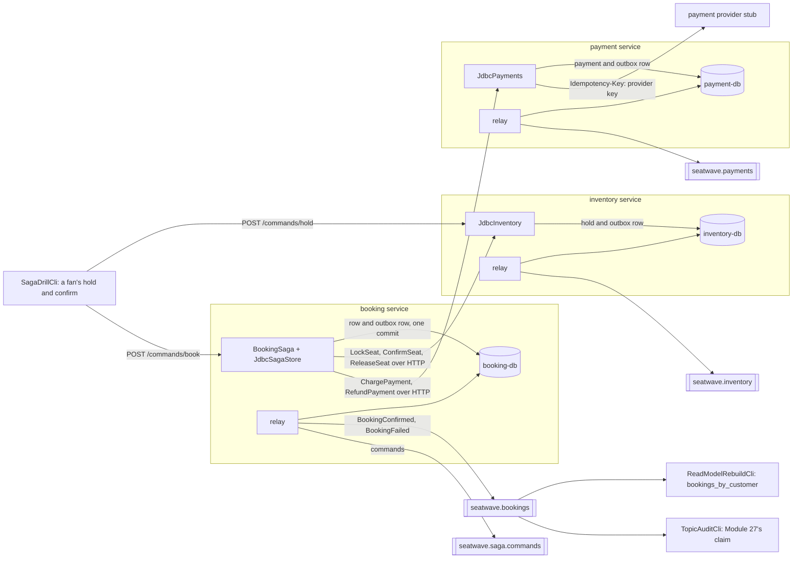

# Architecture

## Packages

| Package | What it holds | Depends on |
|---|---|---|
| `io.plainround.seatwave.saga` | The teaching model, JDK only: `BookingSaga` (the orchestrator and its transition table), `SagaRecord`, `SagaStore`, `SagaParticipants`, `StepReply`; the in-memory services (`ServiceDatabase`, `InventoryService`, `PaymentService`, `LocalParticipants`, `ServiceDatabaseSagaStore`, `SagaWorld`); `EventLog`, `OutboxRelay`, `EventFields`; `BookingsByCustomer`, `BookingHistory`, `EventSchema`; the five programs (`*Cli`) | the JDK |
| `...saga.stub` | `PaymentProviderStub`, the provider's stand-in, one file | the JDK |
| `...saga.jdbc` | `JdbcInventory`, `JdbcPayments`, `JdbcSagaStore`, `JdbcBookingsByCustomer`, `Outbox`, `Transactions` | `saga`, `stack.ProviderClient`, JDBC |
| `...saga.kafka` | `PostgresKafkaRelay`, `RelayLoop`, `Producers` | JDBC, `kafka-clients` |
| `...saga.stack` | HTTP (`CommandServer`, `HttpParticipants`, `ProviderClient`), settings, the three services and the drill tools | everything above |

The dependency rule: the teaching package depends on nothing but the JDK, and nothing in it knows about JDBC, HTTP or Kafka; the orchestrator sees its database and its participants only through `SagaStore` and `SagaParticipants`. The adapters translate rows and HTTP bodies into `StepReply` and `SagaRecord` once, at the edge.

## Data flow

## Walk-through: one booking

1. The fan's hold commits a `holds` row (ACTIVE) and its `SeatHeld` outbox row in inventory's database.
2. `POST /commands/book` starts the saga: one `booking_sagas` row (SEAT_HELD, version 1) and its `LockSeat` outbox row commit together.
3. Each step sends the current state's command over HTTP, then records the next state with its outbox row. Inventory moves the hold to CONFIRMING (the semantic lock); payment calls the provider with the provider key and records `CAPTURED` with `PaymentCaptured`; inventory confirms; the saga completes, writing `BookingConfirmed` and the `bookings` row in the same commit.
4. Each service's relay publishes its outbox rows after their commit, marks them after the broker's acknowledgement, and is fenced by the highest token the database has seen.
5. A crash anywhere leaves the last committed state. On start the booking service resumes every saga that is not final; every command is idempotent under its key, so a repeat returns the first answer.

## Decisions and trade-offs

- **The services run on the host, the infrastructure in Compose.** A drill must kill a service at an exact point by its process id; a host process prints its own id and blocks at the point. The cost: the services' calls to the databases cross Docker Desktop's VM boundary, which every timing states.
- **One broker.** The Docker VM is shared by several projects. The outbox, the relay and the saga do not depend on the broker count; replication does, and Module 27 shows it on three brokers.
- **Direct calls for commands, the outbox for events.** The orchestrator calls participants over HTTP and waits for their answer; the commands also go to `seatwave.saga.commands` as the saga's log, through the outbox, so no command is sent that the saga did not record.
- **The provider's stub keeps money in memory.** It is the provider's ledger for the drills; a restart of the stub forgets it, which no drill does.
- **One price for every seat** (Module 2's $80.00), from settings, for both the charge and `bookings.price_paid`.

## Invariants and where they are enforced

| Invariant | Enforced by | Tested by |
|---|---|---|
| Every saga ends COMPLETED (seat confirmed, one capture kept) or COMPENSATED (seat not claimed, nothing kept) | the transition table (two final states, compensations retried), `final_states_are_final` | `SagaInvariantTest` (96 sagas), `SagaOverHttpStackTest`, `SagaDrillCli verify` |
| Every state change has its event | `ServiceDatabase.commit`; the deferred triggers `hold_change_has_event`, `payment_change_has_event`, `saga_change_has_event` | `SagaInvariantTest`, `JdbcInventoryStackTest` |
| One claim per seat, counting the lock | `one_claim_per_seat` (ACTIVE, CONFIRMING, CONFIRMED); the expiry sweep updates only ACTIVE | `SagaInvariantTest`, `JdbcInventoryStackTest` |
| Every command and compensation is idempotent | conditional updates keyed by hold and saga; one `payments` row per provider key; the provider's idempotency key | `CompensationTest`, `JdbcInventoryStackTest`, `PaymentProviderStubTest`, `SagaOverHttpStackTest` |
| A relay marks only what the broker acknowledged, in commit order, under its fence | `PostgresKafkaRelay` (send all, await all, then mark; `ORDER BY outbox_id`; the fence in the mark's statement) | `OutboxRelayTest`, `PostgresKafkaRelayStackTest` |
| The read model never applies an older version over a newer one | `BookingsByCustomer` and the upsert's `WHERE` | `ReadModelTest`, `JdbcBookingsByCustomerStackTest` |
